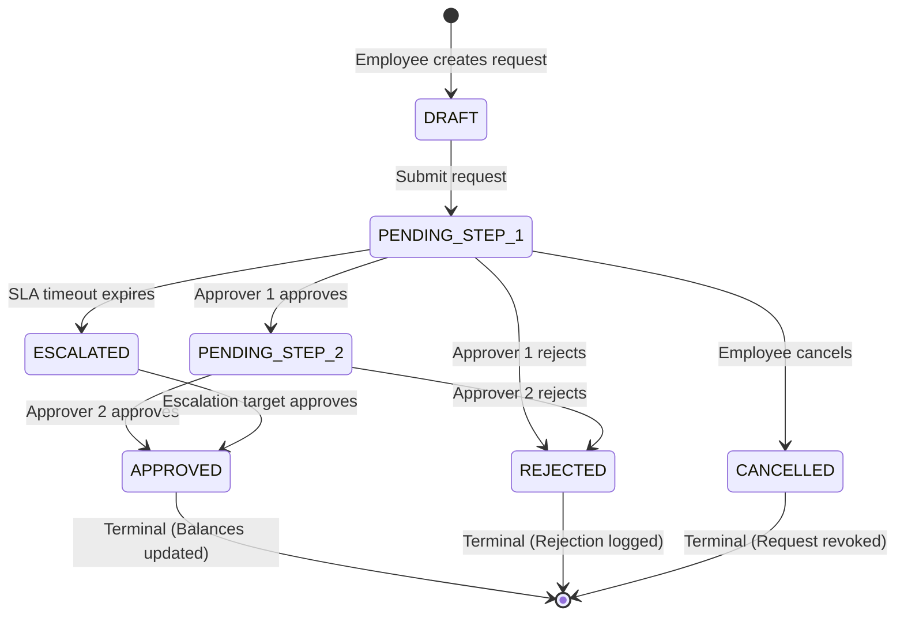
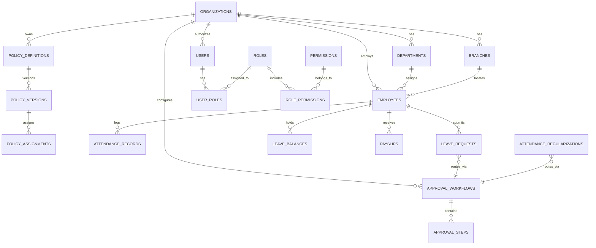

# SOFTWARE DESIGN DOCUMENT (SDD)
# Human Resource Management System (GA-HRMS)
**Enterprise Multi-Tenant SaaS Platform — High-Level & Detailed Technical Design**

---

## Document Control

| Dimension | Details |
| :--- | :--- |
| **Document Title** | GA-HRMS System Design Document (SDD) |
| **Document Version** | 1.0 — Architecture Baseline & Technical Design |
| **Status** | Approved Technical Specification |
| **Author / Architect** | Enterprise Architecture Team / Lead Backend Engineer |
| **Date** | 15 October 2026 |
| **Reference PRD** | HRMS Production PRD v1.2 (Scope Matrix Baseline) |
| **Target Runtime** | Java 21 LTS / Spring Boot 3.4.x / PostgreSQL 16 / React 18 + Vite |
| **Hosting Model** | Cloud Containerized (AWS ECS / EKS or Approved Cloud Platform) |

---

## Table of Contents
1. **Executive Summary & System Vision**
2. **Architectural Principles & Quality Attributes**
3. **C4 Architectural Views (Context, Container, Component)**
4. **Multi-Tenancy & Data Isolation Architecture**
5. **Three-Tier Configuration & Policy Engine Design**
6. **Configurable Workflow & Approval Engine**
7. **Domain Module Technical Design (IAM, Org, Employee, Attendance, Leave, Payroll, Audit)**
8. **Database Architecture, ERD & Data Dictionary**
9. **API Design, Security & Integration Contracts**
10. **Security, Privacy & Compliance Architecture**
11. **DevOps, Scalability & Disaster Recovery**

---

# 1. Executive Summary & System Vision

### 1.1 Purpose
The purpose of this Software Design Document (SDD) is to specify the architectural, logical, physical, and component-level technical design for the **GA-HRMS** platform. This document translates the business and functional mandates specified in the **HRMS Production PRD v1.2** into concrete, robust, and verifiable software constructs.

### 1.2 System Overview
GA-HRMS is an enterprise-grade, multi-tenant Human Resource Management System (HRMS) delivered as a SaaS platform. It serves multiple client organizations (tenants), enabling centralized employee lifecycle administration, shift and attendance tracking, leave balance ledger management, payroll calculation snapshots, employee self-service (ESS), role-based audit trails, and executive reporting.

### 1.3 Architectural Pattern: Modular Monolith
The system is implemented as a **Modular Monolith** built on **Spring Boot 3.4** and **Java 21 LTS**, with a high-performance **React 18 / Vite** single-page frontend and a shared **PostgreSQL 16** relational database. 

```
+-------------------------------------------------------------------------+
|                           GA-HRMS CLIENT                                |
|        React 18 + TypeScript + Vite + Tailwind CSS + Lucide Icons       |
+-------------------------------------------------------------------------+
                                    |
                                    | HTTPS / REST APIs (/api/v1/*)
                                    v
+-------------------------------------------------------------------------+
|                        SPRING BOOT 3.4 BACKEND                          |
|  +-------------------------------------------------------------------+  |
|  |                 Security & Tenant Resolution Context               |  |
|  |       JwtAuthenticationFilter -> TenantContextHolder (ThreadLocal) |  |
|  +-------------------------------------------------------------------+  |
|  |               Three-Tier Configuration & Policy Engine            |  |
|  |    Feature Entitlements | Policy Versioning | Hierarchical Scope  |  |
|  +-------------------------------------------------------------------+  |
|  |                     Layered Modular Domain Core                   |  |
|  |   [IAM]      [Organization]  [Employee]     [Attendance]          |  |
|  |   [Leave]    [Payroll]       [Workflows]    [Audit & Alerts]      |  |
|  +-------------------------------------------------------------------+  |
|  |                Spring Data JPA / Hibernate ORM Layer              |  |
|  |        Automatic Tenant Scoping Filter (@Filter(name="tenant"))    |  |
|  +-------------------------------------------------------------------+  |
+-------------------------------------------------------------------------+
                                    |
                                    | JDBC (HikariCP Pool)
                                    v
+-------------------------------------------------------------------------+
|                         POSTGRESQL 16 DATABASE                          |
|    Row-Level Tenant Scoping | Flyway Migrations | Constraints & Indexes |
+-------------------------------------------------------------------------+
```

---

# 2. Architectural Principles & Quality Attributes

### 2.1 Architectural Invariants
1. **Zero Cross-Tenant Leakage**: No user, background process, query, or report from Tenant A may ever read, alter, or deduce information from Tenant B.
2. **Rule & Calculation Immutability**: Business policies (attendance grace periods, overtime formulas, leave accruals) are versioned. Finalized attendance registers and approved payroll runs are immutable snapshots and never recalculate silently upon policy change.
3. **Decoupled Configuration**: Feature licensing (Platform Entitlements), business rules (Tenant Policy Configuration), and user capabilities (RBAC) are modeled and evaluated as three strictly independent layers.
4. **Backend-Authoritative Security**: The user interface is a presentation projection. Every state transition, record view, and action is strictly evaluated and authorized server-side.
5. **Auditing & Provenance**: All security-critical, financial, policy, and workflow decisions are immutably written to an append-oriented audit ledger.

### 2.2 Quality Attributes (Non-Functional Requirements Matrix)

| Attribute | Quantitative Target | Architectural Tactic |
| :--- | :--- | :--- |
| **Performance** | API p95 < 150ms for OLTP; p99 < 500ms for reports | Composite B-tree indexing on `(tenant_id, employee_id, date)`, HikariCP connection tuning, selective entity fetching |
| **Scalability** | 50,000 active employees across 500 tenants | Stateless JWT authentication, horizontally scalable Spring Boot instances, read-replica database routing |
| **Availability** | 99.9% uptime | Multi-AZ container deployment, health check probes (`/actuator/health`), container self-healing |
| **Data Integrity** | Zero balance or calculation drift | ACID database transactions (`@Transactional`), database unique constraints, optimistic locking (`@Version`) |
| **Security** | Zero critical/high OWASP vulnerabilities | Stateless JJWT (0.12.6), BCrypt (work factor 12), parameterized SQL via JPA, strict CORS, CSP, and TLS 1.3 |

---

# 3. C4 Architectural Views

### 3.1 C4 Level 1: System Context Diagram

```
+-----------------------------------------------------------------------------------+
|                                                                                   |
|    [ Employees ]       [ Managers ]      [ HR Admins ]     [ Payroll Admins ]     |
|   (Punch, Leave,      (Approve Leave,    (Employee Master,  (Salary Structures,   |
|     Payslips)          Regularization)     Org Setup)        Payroll Runs)        |
|          \                  \                //                 //               |
|           \                  \              //                 //                |
|            v                   v            v                   v                 |
|       +---------------------------------------------------------------+           |
|       |                           GA-HRMS                             |           |
|       |             Multi-Tenant Enterprise SaaS Platform             |           |
|       +---------------------------------------------------------------+           |
|                 |                           |                        |            |
|                 v                           v                        v            |
|        [ SMTP Gateway ]            [ Object Storage ]      [ Attendance Devices ] |
|      (Email Notifications)         (Payslip PDFs & Docs)    (Biometric CSV / API) |
|                                                                                   |
+-----------------------------------------------------------------------------------+
```

### 3.2 C4 Level 2: Container Diagram

```
+---------------------------------------------------------------------------------------------+
|                                    GA-HRMS SaaS BOUNDARY                                    |
|                                                                                             |
|  +-------------------------------------+        +----------------------------------------+  |
|  |          Single-Page App            |        |           Spring Boot Backend          |  |
|  |     React 18 / TypeScript / Vite    | =====> |          Java 21 Modular Monolith      |  |
|  |     Tailwind CSS / Radix UI         |  REST  |      Security / REST Controllers       |  |
|  |     Runs in user browser            |  APIs  |      Domain Services / Policy Engine   |  |
|  +-------------------------------------+        +----------------------------------------+  |
|                                                                      |                      |
|                                                                      | JPA / JDBC (HikariCP)|
|                                                                      v                      |
|                                                 +----------------------------------------+  |
|                                                 |           PostgreSQL 16 Database       |  |
|                                                 |        Shared Database, Pooled Schema  |  |
|                                                 |        Row-Level Tenant Isolation      |  |
|                                                 +----------------------------------------+  |
+---------------------------------------------------------------------------------------------+
```

### 3.3 C4 Level 3: Component Diagram (Backend Core)

```
   [ Incoming HTTP Request ]
               |
               v
  +--------------------------+
  | JwtAuthenticationFilter  | ---> Validates Bearer token, extracts claims (email, tenant_id, roles)
  +--------------------------+
               |
               v
  +--------------------------+
  |   TenantContextFilter    | ---> Populates ThreadLocal TenantContextHolder
  +--------------------------+
               |
               v
  +--------------------------+
  |  Spring MVC Controllers  | ---> Validates request DTOs (@Valid), delegates to Domain Services
  +--------------------------+
               |
               +-----------------------------+-----------------------------+
               |                             |                             |
               v                             v                             v
  +--------------------------+  +--------------------------+  +--------------------------+
  |   EntitlementChecker     |  |   WorkflowEngineService  |  |   PolicyResolutionEngine |
  | (Checks tenant features) |  | (Evaluates approval chain|  | (Resolves effective rule |
  |                          |  |  delegation/escalation)  |  |  by org/branch/dept)     |
  +--------------------------+  +--------------------------+  +--------------------------+
               |                             |                             |
               +-----------------------------+-----------------------------+
                                             |
                                             v
                                +--------------------------+
                                |  Domain Business Services| (Employee, Attendance, Leave, Payroll)
                                +--------------------------+
                                             |
                                             v
                                +--------------------------+
                                | Spring Data JPA Repos    | (Enforces tenant_id query filter)
                                +--------------------------+
                                             |
                                             v
                                +--------------------------+
                                |    PostgreSQL Database   |
                                +--------------------------+
```

---

# 4. Multi-Tenancy & Data Isolation Architecture

### 4.1 Tenancy Model: Shared Application, Shared Database with Row-Level Scoping
GA-HRMS employs a **Pooled Database Multi-Tenancy** strategy:
- Every tenant record contains an authoritative `tenant_id` (foreign key to `organizations.id`).
- All foreign keys cascade or restrict strictly within the tenant boundary.
- All primary keys use `BIGSERIAL` or `UUID` with unique composite indexes: `(tenant_id, code)` or `(tenant_id, employee_id, ...)`.

### 4.2 Tenant Context Lifecycle & ThreadLocal Management
1. **Extraction**: The `JwtAuthenticationFilter` parses the cryptographically signed JWT claim `tid` (tenant ID).
2. **Context Binding**: The `TenantContextHolder` binds the resolved `tenantId` to the executing Java thread via `ThreadLocal<Long>`.
3. **Execution**: All JPA repositories and service operations query `TenantContextHolder.getTenantId()`.
4. **Cleanup**: In a `finally` block of `doFilterInternal`, `TenantContextHolder.clear()` is called to prevent ThreadLocal memory leaks or pool cross-contamination.

```java
public final class TenantContextHolder {
    private static final ThreadLocal<Long> CONTEXT = new ThreadLocal<>();

    public static void setTenantId(Long tenantId) { CONTEXT.set(tenantId); }
    public static Long getTenantId() { return CONTEXT.get(); }
    public static void clear() { CONTEXT.remove(); }
}
```

### 4.3 Automated Database Scoping (Hibernate Filter)
All tenant-aware JPA entities extend `TenantAwareBaseEntity` which defines the tenant filter:
```java
@MappedSuperclass
@FilterDef(name = "tenantFilter", parameters = @ParamDef(name = "tenantId", type = Long.class))
@Filter(name = "tenantFilter", condition = "tenant_id = :tenantId")
public abstract class TenantAwareBaseEntity extends BaseEntity {
    @Column(name = "tenant_id", nullable = false, updatable = false)
    private Long tenantId;
    // getter and setter
}
```
An Entity Aspect or JPA Interceptor automatically activates `session.enableFilter("tenantFilter").setParameter("tenantId", TenantContextHolder.getTenantId())` for every database interaction.

---

# 5. Three-Tier Configuration & Policy Engine Design

### 5.1 Configuration Separation Model
To prevent architectural confusion, GA-HRMS models configuration across three isolated planes:

```
+----------------------------------------------------------------------------------------+
|                                    1. FEATURE ENTITLEMENTS                             |
|                  Platform-level licensing: Which modules does this tenant have?        |
|                         [Attendance] [Leave] [Payroll] [Advanced Analytics]             |
+----------------------------------------------------------------------------------------+
                                           |
                                           v
+----------------------------------------------------------------------------------------+
|                                  2. POLICY CONFIGURATION                               |
|              Tenant-level versioned rules: How do business calculations behave?        |
|           [Grace Periods: 15m] [Accrual: Monthly 1.5d] [Overtime: 1.5x after 9h]       |
+----------------------------------------------------------------------------------------+
                                           |
                                           v
+----------------------------------------------------------------------------------------+
|                                  3. ROLES & PERMISSIONS                                |
|                 User-level authorization: What can this specific actor do?             |
|         [ROLE_HR_ADMIN] [ROLE_MANAGER] [ROLE_EMPLOYEE] -> Scoped by Org/Branch/Team    |
+----------------------------------------------------------------------------------------+
```

### 5.2 Hierarchical Policy Resolution Algorithm
When an employee triggers an action (e.g. punches in or submits leave), the system resolves the applicable policy version using **Scope Precedence**:

```
[ Resolution Hierarchy ]
1. Employee-Specific Override  (Highest priority)
2. Shift Policy Assignment
3. Department Policy Assignment
4. Branch Policy Assignment
5. Legal Entity / SBU Policy Assignment
6. Tenant Default Policy        (Fallback baseline)
```

### 5.3 Policy Versioning & Immutability Rules
1. **Effective Dating**: All policy records maintain `effective_from` (inclusive) and `effective_to` (inclusive/nullable).
2. **Immutable Snapshot Locking**:
   - An attendance day record locks its applied policy version ID upon punch pair closure or daily end-of-day reconciliation.
   - A payroll run snapshot locks all salary components, attendance summary days, and policy version IDs upon status `FINALIZED`.
3. **Retroactive Change Isolation**: Updating an attendance grace period on 15 November takes effect starting `effective_from = 2026-11-15`. Historical attendance records from October remain forever evaluated against the October policy version.

---

# 6. Configurable Workflow & Approval Engine

### 6.1 State Machine Specification



### 6.2 Approval Step Configuration
Each request type (Leave, Regularization, Overtime) binds to an `approval_workflow` with ordered `approval_steps`:

| Step Order | Approver Type | Value / Role | SLA Timeout | Action on Timeout |
| :---: | :--- | :--- | :---: | :--- |
| **1** | `REPORTING_MANAGER` | Direct Supervisor | 48 Hours | Escalate to Step 2 |
| **2** | `DEPARTMENT_HEAD` | Department HOD | 24 Hours | Escalate to HR |
| **3** | `ROLE` | `ROLE_HR_ADMIN` | 24 Hours | Alert System Admin |

### 6.3 Concurrency & Segregation of Duties
1. **Optimistic Locking**: Every approval transition increments the entity's `@Version` column. If two approvers act simultaneously, one succeeds and the other receives a `409 Conflict`.
2. **Segregation of Duties**: An employee cannot approve their own request under any circumstance. If a manager submits a leave request, the engine automatically routes the request to the manager's superior.

---

# 7. Domain Module Technical Design

### 7.1 Identity & Access Management (FR-IAM)
- **Entities**: `User`, `Role`, `Permission`, `RefreshToken`
- **Key Technical Decisions**:
  - Stateless authentication using JWT signed with HMAC-SHA256 (`Keys.hmacShaKeyFor`).
  - Refresh tokens persisted in `refresh_tokens` table with cryptographically random tokens and revocation flags.
  - Password security: BCrypt hashing with strength 12.
  - Password recovery: Cryptographic time-limited HMAC tokens (15-minute expiry).

### 7.2 Organization Hierarchy (FR-ORG)
- **Entities**: `Organization` (Tenant), `OrganizationSettings`, `Branch`, `Department`, `Designation`
- **Key Technical Decisions**:
  - Multi-level self-referencing hierarchy for departments (`parent_department_id`).
  - Branches represent physical facilities with location-specific timezones, holiday calendars, and weekly off rules.
  - Organization settings store JSONB configurations for tenant-wide policy fallbacks.

### 7.3 Employee Lifecycle (FR-EMP)
- **Entities**: `Employee`, `EmployeeProfile`, `EmployeeDocument`
- **Key Technical Decisions**:
  - Clear separation between `User` (login authentication credential) and `Employee` (business employment record).
  - Unique employee codes enforced per tenant: `UNIQUE (tenant_id, employee_code)`.
  - Lifecycle state machine: `PROBATION` -> `ACTIVE` -> `NOTICE_PERIOD` -> `SUSPENDED` -> `SEPARATED`.

### 7.4 Attendance & Shift Management (FR-ATT)
- **Entities**: `Shift`, `AttendanceRecord`, `RegularizationRequest`
- **Key Technical Decisions**:
  - Shift crossing midnight supported via `is_overnight = true` flag.
  - Punch calculation handles overnight shifts using explicit day-shift pairing algorithms.
  - Attendance source tracking: `WEB`, `MOBILE`, `BIOMETRIC`, `MANUAL`, `REGULARIZED`.
  - Regularization workflow transactionally updates `worked_minutes` and attendance status upon final approval.

### 7.5 Leave Management (FR-LEV)
- **Entities**: `LeaveType`, `LeavePolicy`, `LeaveBalance`, `LeaveRequest`
- **Key Technical Decisions**:
  - Atomic ledger updates: Leave approval deducts `pending_count` and increments `used_count` transactionally.
  - Overlap validation: Server queries existing requests for `(employee_id, start_date <= req_end AND end_date >= req_start)` where status is not `REJECTED` or `CANCELLED`.
  - Balance calculation formula: `remaining_count = total_allowance - used_count - pending_count`.

### 7.6 Payroll Engine & Payslips (FR-PAY)
- **Entities**: `SalaryComponent`, `SalaryStructure`, `PayrollPeriod`, `PayrollRun`, `Payslip`
- **Key Technical Decisions**:
  - Deterministic calculations: Monetary figures calculated using `BigDecimal` with `RoundingMode.HALF_UP` (never floating point).
  - Snapshot model: `PayrollRun` captures total gross earnings, statutory deductions, and net payout.
  - Payslip access control: Employees can only view finalized payslips mapped to their authenticated `employee_id`.

### 7.7 Business Audit Trail (FR-AUD)
- **Entities**: `AuditEvent`
- **Key Technical Decisions**:
  - Append-only table. No update or delete operations are permitted.
  - Captures: `actor_id`, `actor_email`, `tenant_id`, `action`, `resource_type`, `resource_id`, `before_state`, `after_state`, `ip_address`, `user_agent`, `correlation_id`, `timestamp`.
  - Non-blocking execution via Spring `@Async`.

---

# 8. Database Architecture & ERD

### 8.1 Entity Relationship Diagram (ERD)



### 8.2 Data Dictionary (Key Tables)

#### `organizations` (Tenants)
- `id` (BIGSERIAL, PK)
- `name` (VARCHAR(200), NOT NULL)
- `code` (VARCHAR(50), NOT NULL, UNIQUE)
- `status` (VARCHAR(30), DEFAULT 'ACTIVE')
- `timezone` (VARCHAR(50), DEFAULT 'Asia/Kolkata')
- `currency` (VARCHAR(10), DEFAULT 'INR')
- `created_at`, `updated_at` (TIMESTAMPTZ)

#### `feature_entitlements`
- `id` (BIGSERIAL, PK)
- `tenant_id` (BIGINT, FK -> organizations.id)
- `module_key` (VARCHAR(50), NOT NULL) — e.g. `ATTENDANCE`, `LEAVE`, `PAYROLL`
- `is_enabled` (BOOLEAN, DEFAULT TRUE)
- `effective_from`, `effective_to` (TIMESTAMPTZ)

#### `policy_definitions` & `policy_versions`
- `policy_definitions`: `id`, `tenant_id`, `name`, `policy_type` (`ATTENDANCE`, `LEAVE`, `OVERTIME`)
- `policy_versions`: `id`, `policy_definition_id`, `version_number`, `effective_from`, `effective_to`, `rules_json` (JSONB)

#### `approval_workflows` & `approval_steps`
- `approval_workflows`: `id`, `tenant_id`, `name`, `workflow_type` (`LEAVE`, `ATTENDANCE_REGULARIZATION`), `is_active`
- `approval_steps`: `id`, `workflow_id`, `step_order`, `approver_type` (`MANAGER`, `DEPT_HEAD`, `ROLE`), `target_role_id`, `sla_hours`, `escalation_action`

---

# 9. API Design, Security & Integration Contracts

### 9.1 API Standards
- **Endpoint Structure**: All endpoints are versioned under `/api/v1/*`.
- **Tenant Context**: Automatically injected via Bearer JWT. No URL-polluted tenant parameters (e.g. `/api/v1/employees`, NOT `/api/v1/tenants/12/employees`).
- **Standard Response Envelope**:
```json
{
  "success": true,
  "message": "Operation completed successfully",
  "data": { ... },
  "timestamp": "2026-10-15T09:30:00Z"
}
```
- **Standard Error Envelope (RFC 7807 aligned)**:
```json
{
  "status": 400,
  "errorCode": "VALIDATION_FAILED",
  "message": "Input validation failed",
  "correlationId": "f0a0c006-3390-471b-b1ca-5e4529332efe",
  "validationErrors": {
    "email": "Please provide a valid email address"
  },
  "timestamp": "2026-10-15T09:30:00Z"
}
```

### 9.2 Suggested Endpoint Family Catalogue

| Module | Route Family | Operations |
| :--- | :--- | :--- |
| **Identity & Access** | `/api/v1/auth/*` | `/login`, `/refresh`, `/logout`, `/me` |
| **Organization** | `/api/v1/departments`, `/designations`, `/branches` | CRUD, active hierarchy tree |
| **Employee** | `/api/v1/employees` | Search, filter, retrieve profile, lifecycle state transition |
| **Attendance** | `/api/v1/attendance`, `/attendance-requests` | Punch-in/out, register query, regularization workflow |
| **Leave** | `/api/v1/leave-balances`, `/leave-requests` | View balances, submit request, review approval queue |
| **Payroll** | `/api/v1/salary-structures`, `/payroll-runs`, `/payslips` | Structure assignment, run calculations, finalize, get payslips |
| **Audit Logs** | `/api/v1/audit-events` | Read-only compliance event query |
| **Health** | `/actuator/health`, `/actuator/info` | Operational readiness & health metrics |

---

# 10. Security, Privacy & Compliance Architecture

### 10.1 Authentication & Token Lifecycle
- **Access Token**: JWT signed with HMAC-SHA256, 24-hour lifetime. Contains: `sub` (email), `uid` (user ID), `tid` (tenant ID), `roles` (authorities).
- **Refresh Token**: 7-day lifetime, stored hashed in `refresh_tokens` table. Allows single-use rotation. Revocation invalidates the entire token family.

### 10.2 Authorization Model (Dual-Layer)
1. **Layer 1: Role-Based Access Control (RBAC)**:
   - Method security using `@PreAuthorize("hasAuthority('ROLE_HR_ADMIN')")`.
2. **Layer 2: Record-Level & Relationship Authorization**:
   - Programmatic checks ensuring employees only access their own records (`userId == principal.id`).
   - Managers only access records of direct or indirect reports within their reporting hierarchy.

### 10.3 OWASP Web Security Controls
- **Injection Protection**: Parameterized database queries via Spring Data JPA and Hibernate ORM.
- **Cross-Site Scripting (XSS)**: React automatic output escaping; strict Content Security Policy (CSP).
- **Cross-Site Request Forgery (CSRF)**: Stateless JWT authentication eliminates cookie-based ambient authority; CORS strictly configured for authorized frontend origins.
- **Data Protection at Rest & in Transit**: TLS 1.3 enforced for all transport. Sensitive PII (salaries, tax IDs, banking) encrypted at rest using AES-256 in cloud storage.

---

# 11. DevOps, Scalability & Disaster Recovery

### 11.1 Containerization & Deployment Architecture
- **Docker Multi-Stage Build**: Eclipse Temurin 21 JRE Alpine image (unprivileged `appuser`).
- **Orchestration**: Docker Compose for local development; Kubernetes (EKS/GKE) or AWS ECS Fargate for cloud production.
- **Horizontal Scaling**: Backend containers are completely stateless, allowing elastic horizontal auto-scaling based on CPU/memory metrics.

### 11.2 Database Maintenance & Zero-Downtime Migrations
- **Flyway Database Migrations**: Versioned SQL scripts (`V1__...`, `V2__...`) applied sequentially on startup.
- **Non-Destructive Schema Evolution**: Adding columns must always be nullable or have default values; column renames or drops use multi-phase expand/contract patterns to prevent breaking running instances.

### 11.3 Disaster Recovery & Backup Strategy
- **Automated Backups**: Continuous Write-Ahead Logging (WAL) archiving + daily automated database snapshots.
- **RPO (Recovery Point Objective)**: < 15 minutes.
- **RTO (Recovery Time Objective)**: < 2 hours with automated cloud infrastructure provisioning scripts.
- **Disaster Drill**: Documented restore rehearsals scheduled bi-annually.
